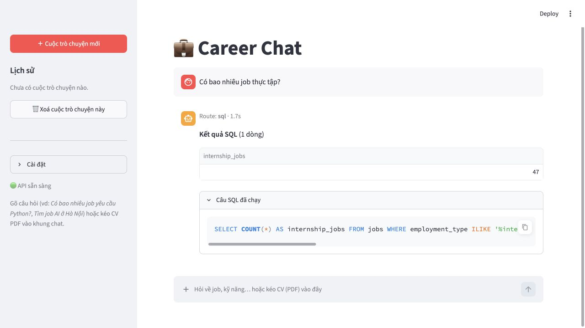
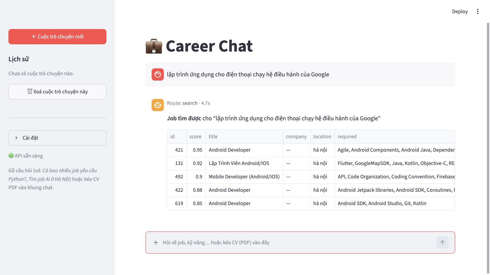
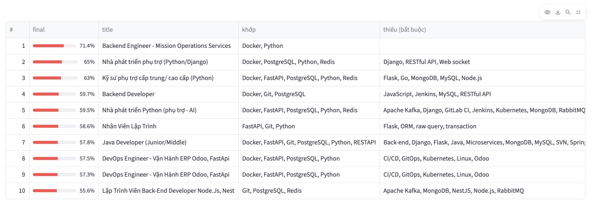
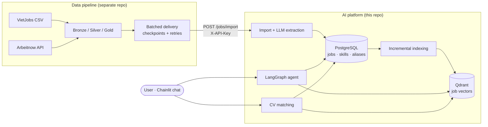
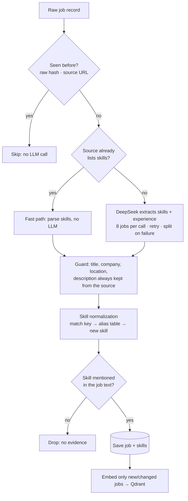
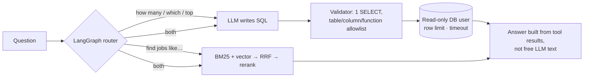
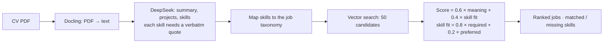
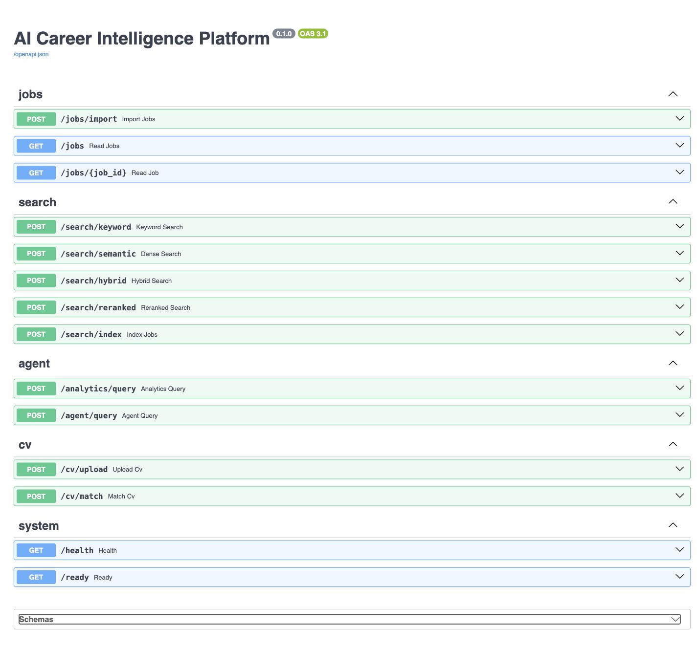

# AI Career Intelligence Platform

**Ask the job market a question, drop in your CV, get matched jobs and the skills you are missing.**

An LLM-powered job platform built on **1,081 real IT job postings** from Vietnam and Europe.
It extracts skills from raw job descriptions, searches jobs by meaning, answers analytics
questions in natural language with safe SQL, and scores a CV against every job.

[](https://github.com/levienbang/ai-career-platform/actions/workflows/ci.yml)


> Jobs arrive from a separate data-engineering pipeline:
> **[Job-Data-Engineering-Pipeline](https://github.com/levienbang/Job-Data-Engineering-Pipeline)**
> (VietJobs dataset + Arbeitnow API → Bronze/Silver/Gold → this platform).



*Natural-language analytics with the result table and the SQL used to produce it.*

---

## What you can do

| You do | The platform | Example |
|---|---|---|
| **Ask an analytics question** | Router picks SQL, LLM writes a query, a validator checks it, a read-only user runs it | *"Có bao nhiêu job thực tập?"* → `42` |
| **Search in plain words** | Keyword (BM25) + vector search, fused with RRF, optional LLM reranking | *"lập trình ứng dụng cho điện thoại chạy hệ điều hành của Google"* → Android jobs |
| **Drop a CV (PDF)** | Reads the PDF, extracts skills with evidence, ranks jobs by meaning **and** skill fit | Top jobs with matched / missing skills |
| **Check a skill gap** | Compares your skills with the jobs you picked | Required skills you lack, ranked by demand |

All of it is available through a FastAPI backend (`/docs`) and a **ChatGPT-style chat (Chainlit)** with admin buttons for stats, skill review, indexing and imports.



*A question describing Google’s phone operating system returns Android jobs.*



*A fictional sample CV produces ranked jobs, match scores, and matched / missing skills.*

---

## How it works

### The big picture



### Importing a job: from raw text to clean, searchable data



### Answering a question



### Matching a CV



---

## Results on real data

Measured on the real VietJobs IT corpus with rule-based labels frozen on the first 941 jobs
([`evaluation/real_cases.json`](evaluation/real_cases.json), script
[`evaluation/evaluate_real_data.py`](evaluation/evaluate_real_data.py)):

| Check | Result |
|---|---|
| Router picks the right tool (SQL / search / both) | **12 / 12** |
| Generated SQL returns the right number | **5 / 5** (all queries validated read-only) |
| Search, query names the skill — precision@5 | BM25 0.96 · vector 1.00 · hybrid 1.00 · + cross-encoder 0.96 |

Paraphrased queries (no skill names), 1081 jobs in the index, Apple M1:

| Method | precision@5 | MRR@10 | median latency |
|---|---|---|---|
| BM25, regex tokens | 0.30 | 0.44 | ~0.4 s |
| BM25 + pyvi compounds | 0.38 | 0.66 | ~0.2 s |
| Vector (Gemini embedding) | **0.88** | 1.00 | ~0.6 s |
| Hybrid RRF | 0.74 | 1.00 | ~0.4 s |
| Hybrid RRF, pyvi BM25 | 0.70 | 1.00 | ~0.4 s |
| Hybrid + `bge-reranker-v2-m3` (local) | 0.80 | 0.93 | ~4.8 s |
| Hybrid + reranker on 200-word chunks | 0.76 | 0.93 | ~7.9 s |

**What the numbers say:** keyword search collapses when users describe a job instead of naming
the skill ("phone OS made by Google" shares no words with "Android"); vector search keeps working.
Vietnamese word segmentation (pyvi) lifts BM25 but not the fused result. The local cross-encoder
recovers part of what equal-weight RRF loses, yet still trails pure vector search and costs ~4 s
on CPU/MPS. A manual 0/1/2 relevance pass over the pooled top-5 (one annotator) agrees: nDCG@5
dense 0.83 · cross-encoder 0.72 · hybrid 0.67. The reranker rarely surfaces unrelated jobs
(≥partial 0.92) but prefers adjacent roles, e.g. tabular Data Scientist jobs for a neural-network
query. `evaluation/evaluate_judge.py` repeats this with an LLM judge at scale.

---

## Engineering highlights

- **The LLM is never trusted blindly.** Extracted skills must appear in the job text; company,
  title and description always come from the source; CV skills need a verbatim quote.
- **Safe text-to-SQL.** One `SELECT` parsed with `sqlglot`, allowlisted tables/columns/functions,
  a read-only database user, row limit and statement timeout.
- **Skill normalization in three cost tiers:** a match key (`Scikit-learn` = `scikit learn`) →
  a curated alias file → LLM alias learning with confidence thresholds, a blocklist and human review.
- **Pay once.** Duplicates are dropped *before* the LLM, indexing only embeds new or changed jobs,
  and alias decisions are cached.
- **Fails loudly, recovers safely.** Bounded retries for transient errors only, batch splitting to
  isolate a bad record, resumable indexing, idempotent imports.
- **Ready for the public internet.** Admin key for writes, per-client and daily limits on routes
  that spend paid API calls, password login on the chat.
- **Evaluation beyond silver labels.** An LLM judge grades pooled (query, job) pairs 0/1/2 for
  judged precision/nDCG and Cohen's kappa against the rule-based labels, with a blind 30-pair human
  sheet.
- **467 offline tests** in CI (fake LLM/embeddings, SQLite, in-memory Qdrant) — no keys, no cost.

---

## Quick start

```bash
cp .env.example .env            # add DEEPSEEK_API_KEY and EMBEDDING_API_KEY (Google)
docker compose up --build -d    # API + PostgreSQL + Qdrant
docker compose exec api python -m scripts.load_demo_jobs   # demo corpus (or import real jobs)
docker compose exec api python -m scripts.index_jobs

cd chat && cp .env.example .env && uv run chainlit run app.py --port 8502   # → http://localhost:8502, admin / admin
```

Optional local models (host machine, not the Docker image):

```bash
uv sync --extra rerank --extra ocr                 # torch + sentence-transformers; ocrmac (macOS)
# bge-reranker-v2-m3 (~2.3 GB) downloads to the Hugging Face cache on first use
# .env: RERANKER_PROVIDER=cross_encoder  KEYWORD_TOKENIZER=pyvi  CV_OCR_ENABLED=true
uv run python -m evaluation.evaluate_real_data      # dry-run; --run compares all retrieval methods
uv run python -m evaluation.evaluate_judge          # dry-run; --run = 54 DeepSeek calls, then cached
```

Scanned CVs: when Docling finds no text layer, the CV is OCR'd with Apple Vision (`vi-VT`, `en-US`).

API docs: <http://localhost:8000/docs>. Real jobs come from the
[pipeline repo](https://github.com/levienbang/Job-Data-Engineering-Pipeline) via `POST /jobs/import`.



## Tech stack

| Layer | Tools |
|---|---|
| API | FastAPI, Pydantic, SQLAlchemy, Alembic |
| Data | PostgreSQL 17, Qdrant |
| AI | DeepSeek (`deepseek-v4-flash`) via LangChain, Google `gemini-embedding-001`, LangGraph, Docling, sqlglot; optional local `BAAI/bge-reranker-v2-m3` (sentence-transformers), pyvi, Apple Vision OCR (ocrmac) |
| UI | Chainlit (chat history in SQLite) |
| Ops | Docker Compose, uv, Ruff, Pytest, GitHub Actions |

## Project layout

```
app/
  api/         HTTP routes (thin)
  ingestion/   import pipeline: dedup → extraction → normalization → persist
  retrieval/   BM25, dense, RRF fusion, reranker, Qdrant indexing
  cv/          PDF → text → extraction → skill gap → job matching
  skills/      taxonomy, alias learning, human review
  graph/ tools/  LangGraph agent, SQL and search tools
scripts/       operations: sync skills, index, learn/review aliases
evaluation/    labelled cases and evaluation scripts
chat/          Chainlit chat UI with admin buttons
```

## Known limitations

- Import is synchronous; at high volume it should move to a queue with background workers.
- BM25 scores every job per query (tokens are cached per document); a full-text index would be needed at scale.
- Job descriptions lose line breaks at ingestion, so chunks follow sentences, not sections.
- The cross-encoder and Mac OCR are optional extras (`uv sync --extra rerank --extra ocr`); the Docker
  image ships neither, so there a scanned CV still fails with "no extractable text".
- Job expiry is not modelled yet; closed postings stay searchable.
- Rate limits are in memory (one API process); behind the chat they act as one global limit.

---

**Deeper details** — settings, design decisions, milestone notes: [docs/REFERENCE.md](docs/REFERENCE.md) ·
deploy: [docs/DEPLOY.md](docs/DEPLOY.md) · scripts: [scripts/README.md](scripts/README.md) · chat: [chat/README.md](chat/README.md)
