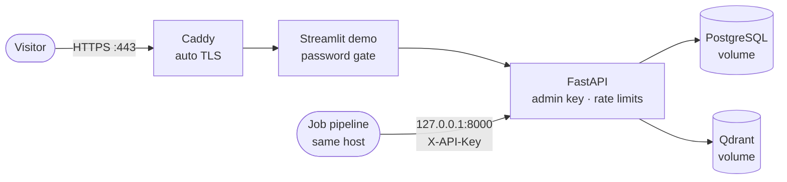

# Deploying the AI platform

One small VPS (2 vCPU / 4 GB is enough; e.g. a DigitalOcean droplet from the GitHub Student
Pack) running `docker-compose.prod.yml`:



Only ports 80/443 are public. The API listens on `127.0.0.1:8000` (pipeline and SSH tunnel);
PostgreSQL and Qdrant have no published ports.

| Guard | Where |
|---|---|
| `APP_ENV=production` refuses to start without `ADMIN_API_KEY` and both rate limits | `app/config.py` |
| Writes (`/jobs/import`, `/search/index`) need `X-API-Key` | `app/security.py` |
| Demo password; no shared chat history; API URL fixed (`DEMO_PUBLIC=true`) | `demo/app.py` |
| CV upload ≤ 5 MB at the proxy, ≤ 2 MB / 5 pages at the API | Streamlit flags, settings |

All visitors reach the API through the demo container, so the per-minute limit acts as a
global limit and `PUBLIC_DAILY_LIMIT` caps the daily spend.

## 1. Server, once

```bash
# Ubuntu 24.04, logged in as a sudo user
curl -fsSL https://get.docker.com | sh && sudo usermod -aG docker $USER   # log out/in
sudo ufw allow OpenSSH && sudo ufw allow 80 && sudo ufw allow 443 && sudo ufw enable
git clone https://github.com/levienbang/ai-career-platform.git && cd ai-career-platform
cp .env.production.example .env && nano .env      # fill every change-me and the API keys
```

`DOMAIN` must point at the server (DNS A record), or use `<server-ip>.sslip.io` for free.

## 2. Move the data you already have (no re-extraction, no re-embedding)

On your machine, with the local stack running:

```bash
deploy/backup.sh                                   # → backups/postgres-*.dump, qdrant-*.snapshot
scp backups/postgres-<stamp>.dump backups/qdrant-<stamp>.snapshot user@server:ai-career-platform/backups/
```

On the server:

```bash
docker compose up -d --build                       # first start creates the empty database
deploy/restore.sh backups/postgres-<stamp>.dump backups/qdrant-<stamp>.snapshot
curl -s 127.0.0.1:8000/ready                       # {"status":"ready",...}
```

Keep `QDRANT_COLLECTION` the same on both machines. Restoring costs no API calls; rebuilding
the vectors instead (`scripts.index_jobs --full`) would embed every job again.

## 3. Backups

```bash
crontab -e
# 03:00 every day, keep 7 days
0 3 * * * cd ~/ai-career-platform && deploy/backup.sh >> backups/backup.log 2>&1
```

A backup on the same disk does not survive losing the server: copy `backups/` off the host
from time to time (`scp`/`rsync` to your machine, or a DigitalOcean Spaces bucket).

## 4. Updating

```bash
git pull                     # main, after the PR is merged
docker compose up -d --build # migrations run on API start (alembic upgrade head)
docker image prune -f
```

Logs: `docker compose logs -f api`. API docs from your machine:
`ssh -L 8000:127.0.0.1:8000 user@server`, then <http://localhost:8000/docs>.

## Sending jobs from the pipeline

Set the pipeline's `AI_PLATFORM_API_KEY` to the server's `ADMIN_API_KEY`. A pipeline running
directly on the host uses `http://127.0.0.1:8000/jobs/import`. A pipeline running in Docker
cannot reach that loopback port; attach its containers to the platform network instead
(`networks: [platform]` with `platform: {external: true, name: ai-career-platform_default}`)
and use `http://api:8000/jobs/import`.
